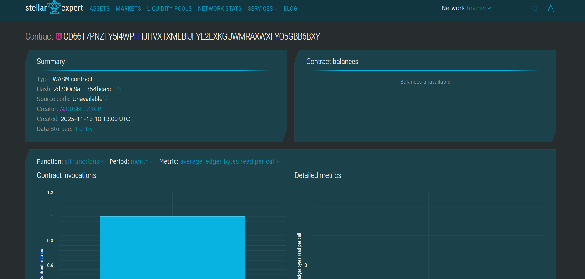

# Gate Pass Management System

## Project Title
**Decentralized Gate Pass Management System on Stellar Blockchain**

## Project Description
The Gate Pass Management System is a blockchain-based smart contract built on the Stellar network using Soroban SDK. This system digitizes and automates the traditional gate pass workflow, enabling organizations to manage entry and exit passes in a transparent, secure, and efficient manner.

The platform allows regular users to create gate passes for entry into premises, administrators to approve these passes, and users to mark their passes as expired upon exit. All pass records are stored immutably on the blockchain, providing a complete audit trail and eliminating paper-based processes. The system tracks comprehensive statistics including approved, pending, and expired passes, making it ideal for corporate offices, educational institutions, residential complexes, and secure facilities.

## Project Vision
Our vision is to transform traditional gate pass management by leveraging blockchain technology to create a secure, transparent, and efficient access control ecosystem. We aim to:

- **Digitize Access Control**: Eliminate paper-based gate passes and move to a fully digital, blockchain-backed system
- **Enhance Security**: Provide immutable records of all entry and exit activities for enhanced security auditing
- **Improve Efficiency**: Automate approval workflows and reduce waiting times for pass generation
- **Enable Transparency**: Create a system where all stakeholders can verify pass authenticity and status
- **Reduce Administrative Burden**: Minimize manual paperwork and streamline the pass management process
- **Support Compliance**: Maintain tamper-proof records for regulatory compliance and security audits

By building on the Stellar blockchain through Soroban, we ensure fast transaction processing, low operational costs, and a scalable solution that can handle high-volume access control requirements.

## Key Features

### 1. **Pass Creation**
- Users can create gate passes with title and description
- Automatic timestamp recording for pass creation time
- Unique ID generation for each pass
- Prevention of multiple active passes per user
- Real-time status tracking from creation to expiration

### 2. **Admin Approval System**
- Administrators can review and approve pending passes
- Authorization workflow ensures only valid passes are approved
- Automatic timestamp recording for approval time (out-time)
- Prevents duplicate approvals and unauthorized modifications
- Clear separation between pending and approved passes

### 3. **Pass Expiration**
- Users can mark their approved passes as expired upon exit
- Automatic timestamp recording for entry time (in-time)
- Validation ensures only approved passes can be expired
- Prevents expiration of already expired passes
- Complete lifecycle tracking from creation to expiration

### 4. **Comprehensive Statistics Dashboard**
- Real-time tracking of total passes created
- Count of approved passes currently active
- Count of pending passes awaiting approval
- Count of expired passes for historical tracking
- Aggregated statistics for administrative oversight

### 5. **Dual View System**
- **User View**: Users can view their pass details including status and timestamps
- **Admin View**: Administrators can view approval status and out-time
- Complete transparency in pass lifecycle
- Easy querying by unique pass ID

### 6. **Security & Access Control**
- Immutable record-keeping on blockchain
- Tamper-proof audit trail for all pass activities
- Unique identification for each pass prevents forgery
- State validation prevents unauthorized status changes
- Complete historical records for security compliance

### 7. **Automated Workflow**
- Sequential status progression (Created → Approved → Expired)
- Validation checks at each stage prevent workflow violations
- Automatic counter management for pass IDs
- Real-time statistics updates with each transaction

## Future Scope

### Short-term Enhancements (3-6 months)
1. **Multiple Pass Types**: Support for visitor, vendor, contractor, and employee passes
2. **Time-based Expiration**: Automatic expiration after specified duration
3. **QR Code Integration**: Generate QR codes for physical verification at gates
4. **Role-based Access**: Multiple admin levels with different permissions
5. **Pass Templates**: Pre-defined templates for recurring pass types
6. **Notification System**: Alerts for pass approval and expiration
7. **Pass Cancellation**: Allow users to cancel pending passes

### Medium-term Development (6-12 months)
1. **Visitor Pre-registration**: Allow hosts to pre-register visitors
2. **Biometric Integration**: Link passes with fingerprint/face recognition systems
3. **Vehicle Pass Management**: Extend system to track vehicle entry/exit
4. **Multi-location Support**: Manage passes across multiple gates/locations
5. **Analytics Dashboard**: Visual insights on pass usage patterns and peak times
6. **Mobile Application**: Native mobile apps for iOS and Android
7. **Integration APIs**: Connect with existing access control hardware
8. **Batch Operations**: Approve multiple passes simultaneously
9. **Pass History**: Complete historical view of user's past passes
10. **Emergency Override**: Admin capability for emergency access control

### Long-term Vision (12-24 months)
1. **AI-powered Risk Assessment**: Automatic flagging of suspicious pass patterns
2. **Smart Contract Automation**: Automatic approval for trusted users/patterns
3. **IoT Integration**: Direct integration with smart gates and turnstiles
4. **Blockchain Interoperability**: Cross-chain support for multi-organization passes
5. **Visitor Management Suite**: Complete visitor experience from parking to amenities
6. **Compliance Reporting**: Automated generation of security audit reports
7. **Predictive Analytics**: Forecast peak times and optimize resource allocation
8. **Contactless Entry**: NFC and RFID integration for touchless access
9. **Multi-tenant Architecture**: Support multiple organizations on single platform
10. **Enterprise Features**: 
    - Integration with HR systems
    - Active Directory/LDAP integration
    - Custom approval workflows
    - Department-wise access control
11. **Advanced Security Features**:
    - Geofencing for pass validity
    - Multi-factor authentication
    - Anomaly detection and alerting
    - Video surveillance integration

### Community & Ecosystem Development
- Open-source community contributions
- Developer SDK for custom integrations
- Plugin marketplace for extended functionality
- Educational resources and best practices documentation
- Partnership with security and facility management companies
- Training programs for administrators and security personnel

### Compliance & Standards
- GDPR compliance for data privacy
- ISO 27001 security standards alignment
- Industry-specific compliance (healthcare, finance, etc.)
- Integration with national ID verification systems
- Support for regulatory reporting requirements

---

## Technical Specifications

**Blockchain**: Stellar Network  
**Smart Contract Framework**: Soroban SDK  
**Language**: Rust  
**Storage Type**: Persistent instance storage  
**TTL (Time to Live)**: 5000 ledgers extension  
**Data Structures**: 
- `Pass` - User pass information
- `Admincontrol` - Admin approval information
- `ApprovalStatus` - System-wide statistics

## Contract Structure

### Data Structures

**Pass Structure:**
- `unique_id`: Unique identifier for the pass
- `title`: Title/purpose of the pass
- `descrip`: Detailed description
- `crt_time`: Pass creation timestamp
- `in_time`: Entry/expiration timestamp
- `isexpired`: Expiration status flag

**Admincontrol Structure:**
- `ac_id`: Admin control ID (matches pass unique_id)
- `out_time`: Approval timestamp
- `approval`: Approval status flag

**ApprovalStatus Structure:**
- `approved`: Count of approved passes
- `pending`: Count of pending passes
- `expired`: Count of expired passes
- `total`: Total pass count

### Core Functions

1. **`create_pass(env, title, descrip) -> u64`**
   - Creates a new gate pass
   - Returns unique pass ID
   - Updates pending count in statistics

2. **`approve_pass(env, ac_id)`**
   - Approves a pending pass
   - Records approval timestamp
   - Updates approved/pending counts

3. **`expire_pass(env, unique_id)`**
   - Marks approved pass as expired
   - Records entry/expiration timestamp
   - Updates expired count

4. **`view_all_pass_status(env) -> ApprovalStatus`**
   - Returns system-wide pass statistics
   - Accessible by administrators

5. **`view_my_pass(env, uniqueid) -> Pass`**
   - Retrieves pass details by ID
   - Returns user-controlled pass information

6. **`view_ac_pass_by_unique_id(env, unique_id) -> Admincontrol`**
   - Retrieves admin control information
   - Returns approval status and timestamp

## Getting Started

### Prerequisites
- Rust (latest stable version)
- Soroban CLI
- Stellar account with testnet tokens

### Installation

1. **Install Rust:**
```bash
curl --proto '=https' --tlsv1.2 -sSf https://sh.rustup.rs | sh
```

2. **Install Soroban CLI:**
```bash
cargo install --locked soroban-cli
```

3. **Add WASM target:**
```bash
rustup target add wasm32-unknown-unknown
```

### Building the Contract

```bash
# Build the contract
cargo build --target wasm32-unknown-unknown --release

# Optimize the WASM (optional)
soroban contract optimize \
  --wasm target/wasm32-unknown-unknown/release/gatepass_contract.wasm
```

### Deployment

```bash
# Deploy to testnet
soroban contract deploy \
  --wasm target/wasm32-unknown-unknown/release/gatepass_contract.wasm \
  --source <YOUR_SECRET_KEY> \
  --rpc-url https://soroban-testnet.stellar.org \
  --network-passphrase "Test SDF Network ; September 2015"
```

### Usage Examples

**Create a Pass (User):**
```bash
soroban contract invoke \
  --id <CONTRACT_ID> \
  --source <USER_SECRET_KEY> \
  --rpc-url https://soroban-testnet.stellar.org \
  --network-passphrase "Test SDF Network ; September 2015" \
  -- create_pass \
  --title "Visitor Pass" \
  --descrip "Meeting with HR Department"
```

**Approve a Pass (Admin):**
```bash
soroban contract invoke \
  --id <CONTRACT_ID> \
  --source <ADMIN_SECRET_KEY> \
  --rpc-url https://soroban-testnet.stellar.org \
  --network-passphrase "Test SDF Network ; September 2015" \
  -- approve_pass \
  --ac_id 1
```

**Expire a Pass (User):**
```bash
soroban contract invoke \
  --id <CONTRACT_ID> \
  --source <USER_SECRET_KEY> \
  --rpc-url https://soroban-testnet.stellar.org \
  --network-passphrase "Test SDF Network ; September 2015" \
  -- expire_pass \
  --unique_id 1
```

**View Pass Status:**
```bash
soroban contract invoke \
  --id <CONTRACT_ID> \
  --rpc-url https://soroban-testnet.stellar.org \
  --network-passphrase "Test SDF Network ; September 2015" \
  -- view_my_pass \
  --uniqueid 1
```

**View Statistics (Admin):**
```bash
soroban contract invoke \
  --id <CONTRACT_ID> \
  --rpc-url https://soroban-testnet.stellar.org \
  --network-passphrase "Test SDF Network ; September 2015" \
  -- view_all_pass_status
```

## Use Cases

### 1. Corporate Offices
- Manage visitor passes for clients and vendors
- Track employee entry/exit times
- Maintain security audit logs
- Automate approval workflows for different departments

### 2. Educational Institutions
- Student entry/exit tracking
- Visitor management for parents and guests
- Event-specific passes for conferences and seminars
- Contractor access control

### 3. Residential Complexes
- Visitor pass management for residents
- Vendor and delivery personnel tracking
- Event passes for community gatherings
- Security audit trails for incidents

### 4. Healthcare Facilities
- Patient visitor management
- Vendor and supplier access control
- Staff entry/exit tracking
- Compliance with healthcare regulations

### 5. Government & Secure Facilities
- High-security access control
- Complete audit trail for compliance
- Multi-level approval workflows
- Integration with existing security systems

## Security Considerations

- All pass data is stored immutably on the blockchain
- State validation prevents unauthorized status changes
- Unique IDs prevent pass duplication or forgery
- Timestamp verification provides audit capabilities
- Admin-only functions protect critical operations

## Testing

```bash
# Run unit tests
cargo test

# Run integration tests (if implemented)
cargo test --test integration_tests
```

## Contributing

We welcome contributions from the community! Please follow these steps:

1. Fork the repository
2. Create a feature branch (`git checkout -b feature/AmazingFeature`)
3. Commit your changes (`git commit -m 'Add some AmazingFeature'`)
4. Push to the branch (`git push origin feature/AmazingFeature`)
5. Open a Pull Request

## License

This project is open-source and available under the MIT License.

## Support & Contact

For questions, bug reports, or feature requests:
- Open an issue on GitHub
- Contact the development team
- Join our community channels

## Acknowledgments

- Built on Stellar blockchain using Soroban SDK
- Inspired by the need for secure and transparent access control
- Thanks to the Stellar and Soroban developer community

---

## Contract Details 
CBQKSIEB7LBTFP4XMEALNCAVETZ2Q7HAEBMGAA2PJ73HEHKLBOURG72Q
